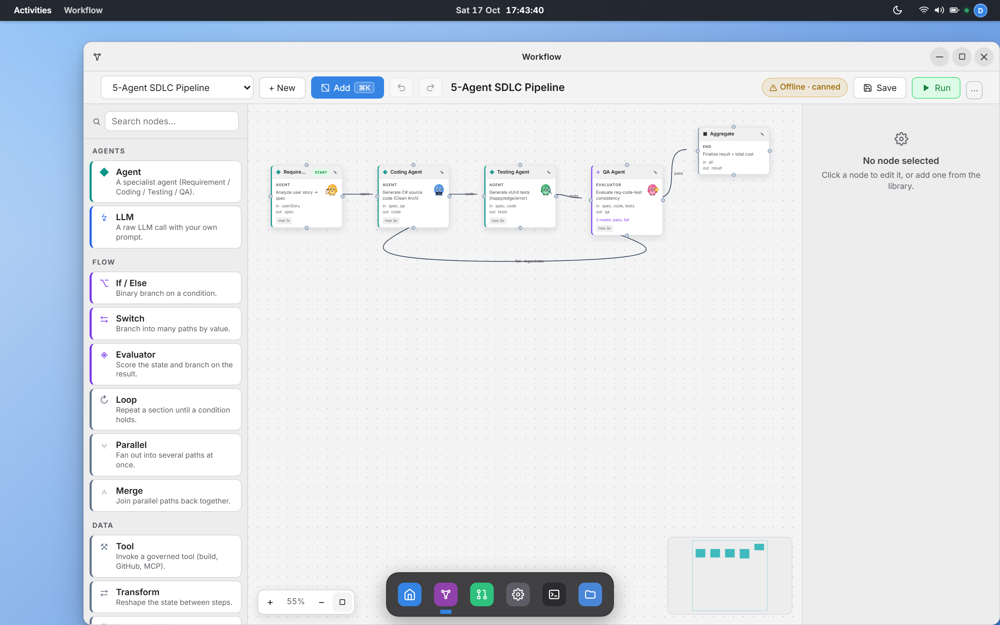
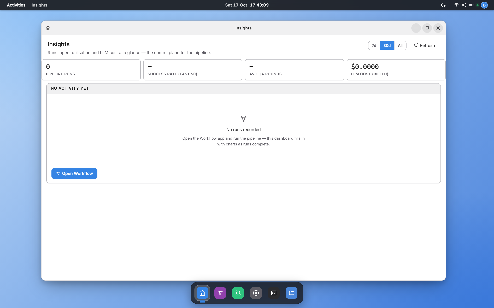
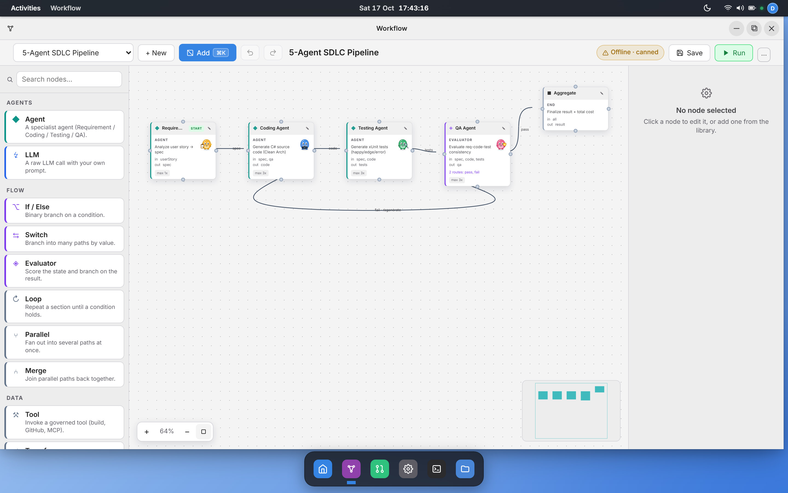
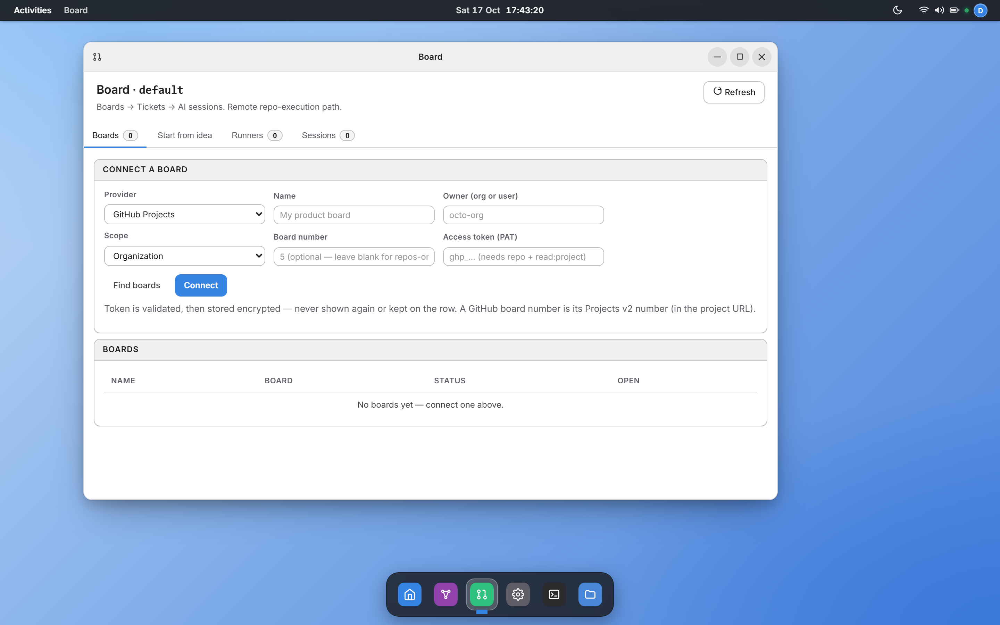
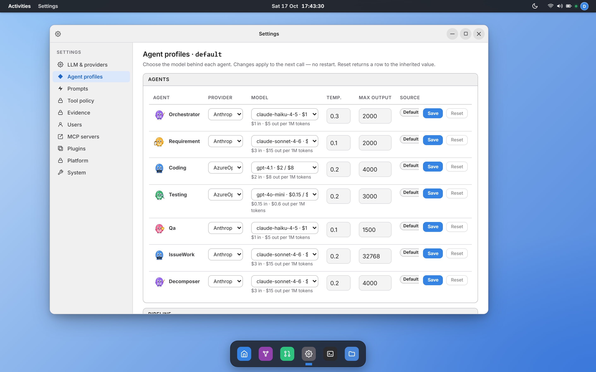
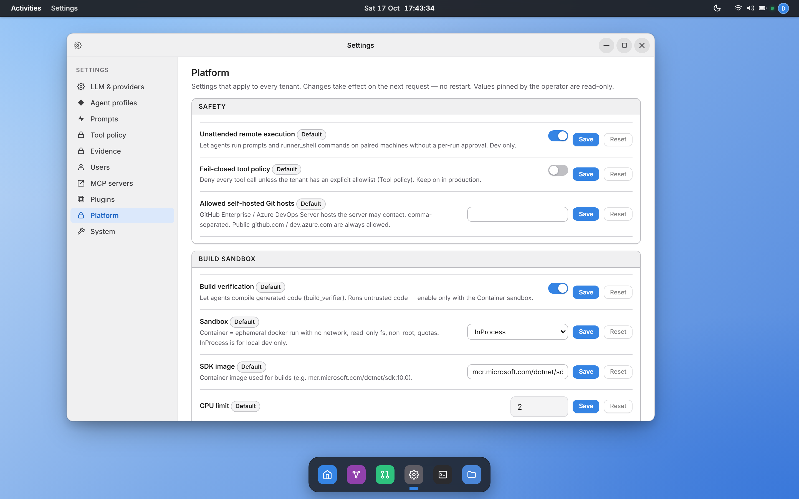
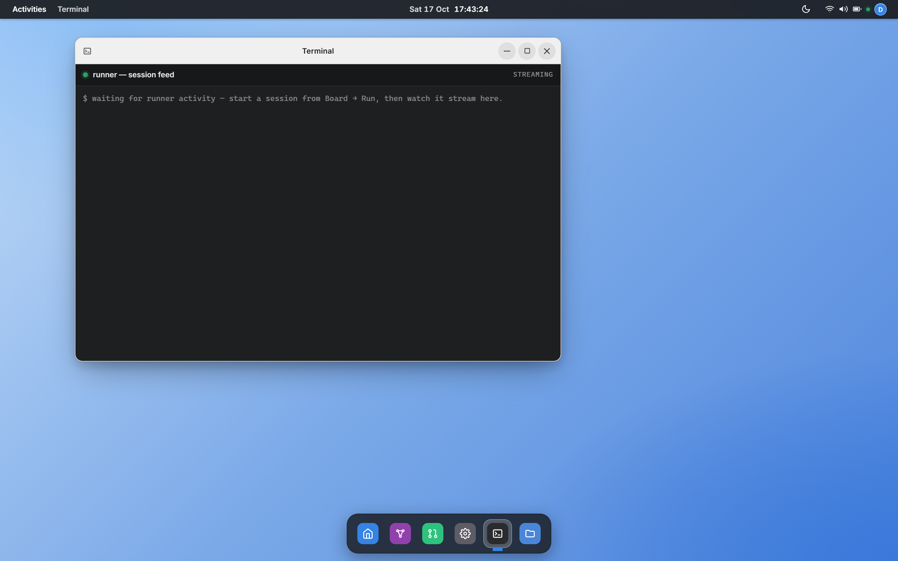
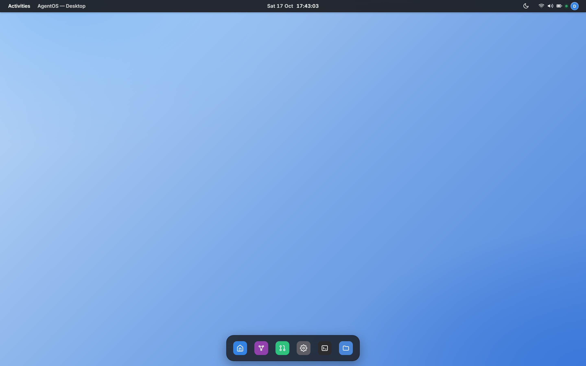
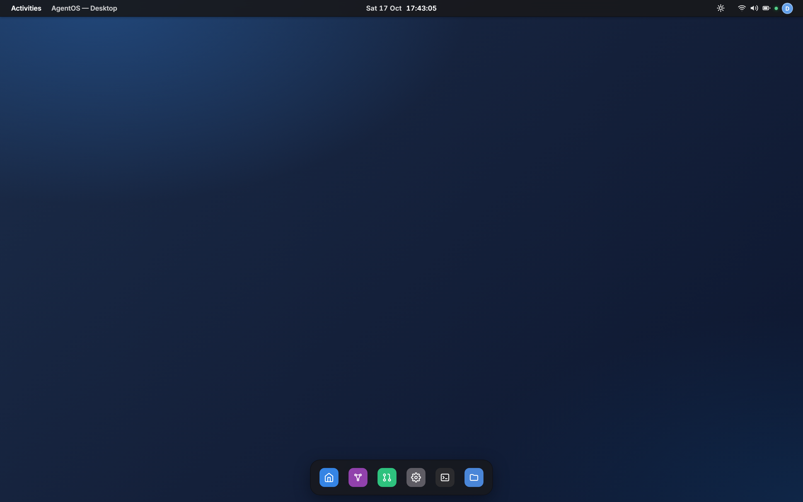

<p align="center">
  
</p>

# AgentOS.NET

> A **modular .NET agentic platform** for software delivery. A central orchestrator coordinates
> specialist agents — Requirements → Code → Tests → QA — over a provider-agnostic LLM gateway, on a
> multi-tenant runtime with row-level isolation, driven from a Blazor desktop UI.

[](https://github.com/hoangsnowy/AgentOS.NET/actions/workflows/ci.yml)
[](LICENSE)


[](CONTRIBUTING.md)

<p align="center">
  
  <br>
  <sub><em>The <strong>AgentOS.NET</strong> desktop — a Blazor Server window manager with an authentic GNOME shell (Activities overview, virtual workspaces, Dash). Every capability is a window: Insights, the visual Workflow editor (where runs start), Board, Settings, Terminal, Files.</em></sub>
</p>

AgentOS.NET turns a plain-English user story into reviewed, test-backed C# code. Five agents collaborate
under an orchestrator; a QA agent scores requirement ↔ code ↔ test consistency and loops until the
result converges or an iteration cap is hit. Every model call is metered (tokens, cost, latency),
every tool call passes a policy gate and is recorded as evidence, and every setting is changed in the
desktop — not in a config file.

The platform is a **modular monolith**: each feature (LLM gateway, pipeline, identity, tenants,
settings, tools, integrations, MCP, workspaces, sessions, remote agent) is a self-contained `IModule`
with its own DI surface, EF Core context and Postgres schema, so any one can later ship as a package.

> **Status:** pre-1.0. The pipeline, gateway, modular runtime, multi-tenant identity and the desktop
> are working and deployed on Azure Container Apps; public surfaces may still change before `v1.0`.

**Contents:** [Quick start](#quick-start) · [Screenshots](#screenshots) · [Why AgentOS.NET](#why-agentos) ·
[Concepts](#concepts) · [Architecture](#architecture) · [Modules](#modules) ·
[LLM gateway](#llm-gateway) · [Configuration](#configuration) · [Multi-tenant](#multi-tenant) ·
[API](#api) · [Extending](#extending) · [Deploy](#deploy) · [Contributing](#contributing)

### Which doc do I read for X?

| I want to… | Read |
|---|---|
| Run it locally (standalone or full stack), secrets, CI | [docs/SETUP.md](docs/SETUP.md) |
| Test against real GitHub / Azure DevOps / LLMs (the lab server) | [docs/LAB.md](docs/LAB.md) |
| Know what to set at deploy vs in the UI | [docs/CONFIG.md](docs/CONFIG.md) |
| Understand the architecture | [docs/architecture.md](docs/architecture.md) · [ADRs](docs/adr/README.md) |
| Deploy to Azure | [docs/DEPLOYMENT.md](docs/DEPLOYMENT.md) · [infra/README.md](infra/README.md) · runbooks: [Keycloak](docs/keycloak-prod-runbook.md), [DataProtection DR](docs/dataprotection-dr-runbook.md) |
| Contribute / conventions | [CONTRIBUTING.md](CONTRIBUTING.md) |
| Build UI | [docs/design/design-system.md](docs/design/design-system.md) |
| See where it's going | [ROADMAP.md](ROADMAP.md) · [execution plan](docs/plans/agentic-sdlc-v2.md) |
| Report a vulnerability | [SECURITY.md](SECURITY.md) |

## Quick start

Prerequisites: **.NET 10 SDK** (pinned in `global.json`). Docker only for the full stack.

### 1 — Standalone desktop (one command, no Docker, no API keys)

```bash
git clone https://github.com/hoangsnowy/AgentOS.NET.git
cd AgentOs
dotnet run --project src/AgentOs.Web
```

Open **http://localhost:5180**. You are signed in automatically as a Development user (with admin and
platform-admin rights). Open **Workflow** → **Run**: with no API key configured, agents answer with
canned, schema-valid output that is labelled **Offline** everywhere — the run, the chip, the Run Log —
so you can explore the whole flow before spending a token.

Standalone is the *degraded* mode: there is no database (settings and runs live in memory and reset on
restart) and no real identity provider. Use it for UI work and first contact; use the full stack for
anything involving persistence, sign-in or multiple tenants.

### 2 — Full stack (Postgres + Keycloak + MailHog + Api + Web)

```bash
dotnet run --project infra/AgentOs.AppHost
```

| What | Where |
|---|---|
| Aspire dashboard | https://localhost:17050 |
| AgentOS.NET desktop | https://localhost:5180 — sign in as `operator` / `operator` (realm `agentic`) |
| Api + Scalar UI | https://localhost:5080/scalar/v1 |

If the first run misbehaves, it is almost always one of three known causes — a stale Docker volume
(Postgres password or old Keycloak realm), or HTTP 431 from an overfull `localhost` cookie jar (use an
incognito window). Fixes are in [docs/SETUP.md](docs/SETUP.md#troubleshooting-the-full-stack).

### 3 — Use a real model

In the desktop: **Settings → AI → Model keys** (or press **Ctrl+K** and type "add key") — one card per
provider (Anthropic, Azure OpenAI, OpenAI, Gemini, xAI): paste the key, Save, then **Test** (stored
encrypted, per tenant). Then pick each agent's model in **Settings → Agent profiles**;
the next run uses it, no restart. Keys can also be seeded from the environment
(`Llm__Claude__ApiKey`, user-secrets) — see [docs/CONFIG.md](docs/CONFIG.md).

**Or use your own computer and AI plan** (Claude Code / Codex, no server key): **Board → Computers →
Connect this computer** shows one command with a one-time code — run it on that computer, in the helper's
folder (`dotnet run --project src/AgentOs.RemoteAgent -- pair <address> <code>` from a checkout). The
page turns *Connected* by itself; later starts need no arguments. Connecting the same computer again (same
name) retires its old offline entry and token. Board tasks set to *On my computer* then
clone, edit, build, test and push in a private per-task folder (`src/AgentOs.RemoteAgent/ScopedAutonomy.cs`).

**Try the app** (Board → a project → *Try the app*) runs the latest default branch on that same computer and opens it
— no terminal. The project says how in `.agentos/preview.json`:

```json
{ "command": "dotnet run --project infra/MyApp.AppHost", "url": "http://localhost:5173", "readyTimeoutSeconds": 600 }
```

The command is shown before anything runs, and the computer re-reads it from its own checkout and refuses if it
changed. A project without the file gets an *Ask the AI to set it up* button that opens a ticket for it. Testing on
that project waits while the app runs (same ports). `REMOTE_AGENT_PREVIEWS=off` refuses previews on a computer.

### 4 — Build and test

```bash
dotnet build AgentOs.slnx -c Release
dotnet test  --solution AgentOs.slnx -c Release          # xUnit v3 on Microsoft.Testing.Platform
dotnet test  --project tests/AgentOs.Tests --filter-class "*CostCalculatorTests"   # one class
```

UI end-to-end tests (Playwright) run against a running Web:

```bash
# terminal 1
ASPNETCORE_ENVIRONMENT=Development dotnet run --project src/AgentOs.Web --urls http://localhost:5199 --no-launch-profile
# terminal 2
RUN_AGENTOS_E2E=true AGENTOS_URL=http://localhost:5199 dotnet test --project tests/AgentOs.E2E.Tests
```

`RUN_AGENTOS_E2E_REAL=true` runs the real-auth suite against the full Aspire stack instead.

## Screenshots

All shots are the standalone Web (`dotnet run --project src/AgentOs.Web`).

| Insights — the control plane | Visual workflow editor — the run surface |
|:---:|:---:|
| [](docs/images/app-insights.png) | [](docs/images/app-workflow.png) |
| Runs, success rate, QA rounds and LLM cost (billed, plus the would-be API cost on the free dev-runner path), per-agent load, spend by model, latency, and the monthly budget cap. | Build and **run** the agents as an editable graph — Agent, LLM, Tool, Evaluator, Loop, Parallel, Human nodes. Each agent node shows a character acting out its live state. |

| Boards → Tickets → Sessions | Settings |
|:---:|:---:|
| [](docs/images/app-board.png) | [](docs/images/app-settings.png) |
| Connect a GitHub / Azure DevOps board, decompose an idea into tickets, drive repo-execution sessions. | One searchable rail: AI (Model keys, Routing, Agent profiles, Prompts) · Connections · Governance · People & data · Personal · System. Ctrl+K finds any setting. Changes apply on the next call. |

| Platform governance | Terminal — runner session feed |
|:---:|:---:|
| [](docs/images/app-platform.png) | [](docs/images/app-terminal.png) |
| Platform-admin settings for every tenant: remote auto-approve, fail-closed tool policy, allowed Git hosts, and the build sandbox (mode, image, quotas). Production pins the risky ones as read-only operator locks. | A read-only live tail of what a paired remote agent is doing. |

Light and dark are first-class (top bar → appearance toggle, or System → Appearance):

| Light | Dark |
|:---:|:---:|
| [](docs/images/desktop-light.png) | [](docs/images/desktop-dark.png) |

## Why AgentOS.NET

- **Modular by construction.** Every feature is an `IModule` discovered by reflection; hosts wire the
  whole platform with one `services.AddModulesFromAssemblies(cfg, …)` call. Modules depend on
  `Domain` + `SharedKernel`; the few cross-module references are explicit (see
  [Architecture](#architecture)).
- **Provider-agnostic LLM gateway.** Claude, Azure OpenAI, OpenAI, Google Gemini, xAI Grok, any
  OpenAI-compatible server, Microsoft Agent Framework and a paired dev-machine agent are interchangeable
  `ILlmClient`s; each tenant brings its own keys. Pick per agent in the desktop — no code
  change, no restart.
- **Measured.** Every call records tokens in/out, cost and latency per run and agent. Prices come from
  a built-in table of official list prices (Claude 5.x, GPT-6/5.x, o-series, incl. prompt-cache and
  long-context tiers); an unknown model is charged at a fail-closed ceiling, never `$0`, so it cannot
  slip past the budget gate.
- **Governed.** Tools run only through `IToolGateway` → per-tenant policy → evidence log. Production
  pins the riskiest switches (remote auto-approve, tool enforcement, offline fallback, build sandbox)
  as operator locks the UI cannot flip. Third-party text in prompts is fenced as untrusted input.
- **Multi-tenant from day one.** Keycloak OIDC `tenant` claim → `ITenantContext`; row-level isolation
  through EF Core global query filters; per-tenant keys, settings and audit.
- **Honest.** Canned offline output is labelled Offline end to end and never opens a PR; a standalone
  run says what it can't persist.
- **Resilient gateway.** Multi-key pools with round-robin, HTTP 429 cooldown honouring `Retry-After`,
  and optional inter-provider failover chains.
- **Cloud-ready.** A .NET Aspire AppHost runs the full stack locally; `azd up` deploys it to Azure
  Container Apps.

## Concepts

| Concept | Lives in | Notes |
|---|---|---|
| **Module** | `IModule` (SharedKernel) | One assembly = one module. Optional `IEndpointModule` (HTTP), `IInitializableModule` (startup hook), `ISettingsContributor` (settings it owns). |
| **Agent** | `Modules.Pipeline.Agents` | A specialist — Requirement, Coding, Testing, QA, Orchestrator (+ IssueWork, Decomposer). Talks to models only through `ILlmClientFactory`. |
| **LLM client** | `Domain.Llm.ILlmClient` | `SendAsync(LlmRequest, ct) → LlmResponse`, registered as a keyed service under its provider name. |
| **Setting** | `Domain.Configuration.SettingDescriptor` | Key, kind, scope, default, validation, UI label. Resolved lock → tenant → platform → seed → default ([ADR-0011](docs/adr/0011-ui-first-configuration.md)). |
| **Tool** | `Domain.Tools.ITool` | Invoked by models via the gateway, always through `IToolGateway` (policy → invoke → evidence). |
| **Tenant context** | `SharedKernel.Identity.ITenantContext` | Tenant id, user id, roles for the request. DbContexts filter by `TenantId`; repositories stamp it on write. |

## Architecture

```
src/
├── AgentOs.Domain/              # Provider-neutral DTOs + contracts: ILlmClient, ITool/IToolGateway, settings, pipeline artifacts
├── AgentOs.SharedKernel/        # IModule contracts + ModuleLoader, ITenantContext, plugins (IAgentOsPlugin)
├── AgentOs.Modules.AppConfig/   # Settings registry + encrypted per-tenant KV store (schema: config)
├── AgentOs.Modules.Llm/         # Gateway: keyed providers, key pool + 429 failover, cost, model capabilities
├── AgentOs.Modules.Pipeline/    # Agents, prompts, orchestrator, graph executor, run history (schema: pipeline)
├── AgentOs.Modules.Identity/    # Keycloak JWT auth, HttpTenantContext, Admin/Member/PlatformAdmin policies
├── AgentOs.Modules.Tenants/     # Tenant registry, Keycloak admin client, invitations, audit (schema: tenants)
├── AgentOs.Modules.Tools/       # Tool registry, per-tenant policy, invocation evidence (schema: tools)
├── AgentOs.Modules.Integration/ # GitHub PR service + sandboxed build verifier (exposed as tools)
├── AgentOs.Modules.Mcp/         # MCP client: upstream MCP servers' tools join the tool registry
├── AgentOs.Modules.Workspaces/  # Connected repos/boards + connectors (schema: workspaces)
├── AgentOs.Modules.Sessions/    # Remote-runner registry, pairing, session-run feed (schema: sessions)
├── AgentOs.Modules.RemoteAgent/ # SignalR hub + RemoteAgentLlmClient (work runs on a paired dev machine)
├── AgentOs.Api/                 # Minimal API + Scalar + MCP server at /mcp — composition root
├── AgentOs.Web.Shell/           # Desktop shell: window manager, Dash, toasts, Btn/Field/Panel/Icon UI kit
├── AgentOs.Web/                 # Blazor Server desktop + product apps — composition root
├── AgentOs.RemoteAgent/         # Standalone dev-machine agent that pairs to the hub
└── AgentOs.ServiceDefaults/     # OpenTelemetry, health checks, HTTP resilience, Kestrel limits
infra/AgentOs.AppHost/           # .NET Aspire orchestration (+ infra/keycloak realm & theme, azd hooks)
samples/AgentOs.Plugins.Sample/  # A working out-of-tree plugin
tests/                           # xUnit v3 (1,000+ test cases) + Playwright E2E
tools/agentos-vscode/            # VS Code extension: pair the editor as a runner
```

Cross-module references are explicit and minimal: Llm, Pipeline, Tools and Workspaces → AppConfig
(settings + per-tenant store); Tenants → Identity (JWT scheme); Integration → Llm + Tools (its tools
register through the tool registry). Hosts reference every module.

### Tools & MCP

Agents call **tools** (`build_verifier`, MCP-exposed GitHub / filesystem actions, custom `ITool`s)
through the gateway: `LlmRequest.Tools = ["build_verifier"]` makes `PooledChatLlmClient` resolve each
name in `IToolRegistry`, adapt it into a `Microsoft.Extensions.AI.AIFunction`, and run the tool-call
loop with `FunctionInvokingChatClient`. Every invocation passes `IToolPolicy` (gate) and
`IToolInvocationLog` (evidence), so refused and successful calls alike are auditable.

`AgentOs.Modules.Mcp` connects to upstream **MCP servers** and registers their tools as
`{server}.{tool}` — local and remote tools share one registry. The Api also **serves MCP** at `/mcp`
(Streamable HTTP) with `run_pipeline`, `list_runs` and `get_run`, so any MCP host (Claude Desktop,
VS Code, another orchestrator) can drive AgentOS.NET.

### Pipeline dataflow

```
UserStory ─► RequirementAgent ─► RequirementSpec ─► CodingAgent ─► CodeArtifact
                                                                       │
                                                                       ▼
                                       PipelineResult ◄── QaAgent ◄── TestingAgent
                                              │
                                              └── run history (pipeline.pipeline_runs + run_metrics)
```

QA scores the triple and decides "ship it" or "iterate" (capped by `NMax`, default 3). The Workflow
editor runs the same agents as a graph, including Parallel, Merge, If/Else, Loop and Human nodes.

## Modules

| Module | Schema | Endpoints | Notes |
|---|---|---|---|
| **AppConfig** | `config` | `/settings*` | Settings registry (descriptors, precedence, locks, audit) over an encrypted per-tenant KV store. |
| **Llm** | — | `/llm/test` | Keyed `ILlmClient` per provider, key pools, failover, cost calculator, model capabilities. |
| **Pipeline** | `pipeline` | `/pipeline`, `/pipeline/stream`, `/requirement`, `/code`, `/test`, `/qa`, `/runs*` | Agents, orchestrator, graph executor, run history (jsonb artifacts). |
| **Identity** | — | — | `ITenantContext` + `Admin`/`Member`/`PlatformAdmin` policies. Scheme per host (Api = JWT bearer, Web = cookie + OIDC). |
| **Tenants** | `tenants` | `/tenants*`, `/invitations*` | Tenant registry, member lifecycle via the Keycloak admin API, signup + invitations, audit. |
| **Tools** | `tools` | — | Tool registry, per-tenant policy (allowlist), invocation evidence. |
| **Integration** | — | — | `IGitHubPrService` + `IBuildVerifier` (container sandbox), registered as tools. |
| **Mcp** | — | `/mcp/servers` | MCP client for upstream servers; the Api also serves `/mcp`. |
| **Workspaces** | `workspaces` | `/workspaces*` | Connected repos/boards + `IWorkspaceConnector` (GitHub, Azure DevOps). |
| **Sessions** | `sessions` | `/sessions*`, `/runners*`, `/pair/*` | Remote-runner registry, pairing handshake, live session-run feed. |
| **RemoteAgent** | — | `/hubs/remote-agent` (SignalR) | Dispatches work to a paired dev-machine agent (no server API tokens). |

## LLM gateway

Agents depend only on `ILlmClient`; `LlmClientFactory` resolves a keyed implementation by provider:

| Provider | Backend | Owning module |
|---|---|---|
| `Claude` (alias `Anthropic`) | Anthropic SDK, pooled over multiple keys | `Modules.Llm` |
| `AzureOpenAI` | `Azure.AI.OpenAI`, pooled over multiple keys | `Modules.Llm` |
| `OpenAI` · `Gemini` (alias `Google`) · `xAI` (alias `Grok`) | Bring-your-own-key vendors over the OpenAI protocol — fixed endpoints, tenant-scoped keys, built-in prices | `Modules.Llm` |
| `OpenAICompatible` (aliases `Ollama`, `vLLM`, `Local`) | Any `/v1/chat/completions` server via the OpenAI SDK — self-hosted / air-gapped, your own prices | `Modules.Llm` |
| `MAF` | Microsoft Agent Framework over Azure OpenAI | `Modules.Llm` |
| `RemoteAgent` | SignalR-dispatched dev-machine agent | `Modules.RemoteAgent` |
| `Offline` | Keyless canned output — only at the end of a failover chain when offline fallback is on | `Modules.Llm` |

Routing per call: `Llm:ForceProvider` (if set) → the agent profile's provider → `Llm:Provider`.
`Llm:Fallbacks` adds inter-provider failover (e.g. Claude → AzureOpenAI) above each provider's own
key-pool failover. Keys and routing are read **per request** for the caller's tenant (short cache),
so a key saved in Settings is used by the next call.

**Default agent profiles** (code defaults — change them in Settings → Agent profiles):

| Agent | Provider | Model |
|---|---|---|
| Orchestrator | Claude | `claude-haiku-4-5` |
| Requirement | Claude | `claude-sonnet-4-6` |
| Coding | AzureOpenAI | `gpt-4.1` |
| Testing | AzureOpenAI | `gpt-4o-mini` |
| QA | Claude | `claude-haiku-4-5` |
| IssueWork / Decomposer | Claude | `claude-sonnet-4-6` |

The model picker lists every priced model for the chosen provider with its list price (e.g.
`claude-haiku-5-5 · $0.1 / $0.5` per 1M tokens), plus *Custom…* for Azure deployment aliases.

## Configuration

**UI-first** ([ADR-0011](docs/adr/0011-ui-first-configuration.md)). Everything product-related is set
in the desktop and applies on the next call:

- **Home → Schedule…** — run a story once or on a schedule (every day / weekdays / weekly / cron, UTC; at most every
  15 minutes). Scheduled runs go through the same budget gate and run limits as any run, and every change is audited.
- **Settings → AI → Model keys** — one card per provider: key, endpoint / default model, and a Test button.
- **Settings → AI → Routing** — default and forced provider, offline fallback.
- **Settings → AI → Agent profiles** — the model per agent (the provider follows the model) and the QA-loop cap;
  provider, temperature and max output tokens under **Show advanced**.
- **Settings → Platform** (`platform-admin` only) — remote auto-approve, fail-closed tool policy,
  allowed self-hosted Git hosts, build sandbox (mode, image, quotas), offline fallback.
- **Settings → Prompts** — per-tenant system prompts for the Requirement, Coding, Testing and QA agents.
- **Settings → Audit log** — who changed what (settings, keys — never their values —, members, sign-in), CSV export.

**Your repo's own rules.** When a Board ticket runs against a repo, every agent follows the repo's agent
instructions — `.agentos/instructions.md`, `AGENTS.md`, `CLAUDE.md`, `.github/copilot-instructions.md`,
`.cursorrules` (budgeted to ~4k tokens, fenced below the agent's own rules); the session feed names the
files it used.

`appsettings.json` holds bootstrap keys only — database, sign-in, logging, operator locks. Any setting
can still be **seeded** from the environment (`Agents__Coding__Model=gpt-5.4`, `Llm__Claude__ApiKeys__0=…`).
The full reference — what you set at deploy vs in the UI, precedence, Production locks — is
[docs/CONFIG.md](docs/CONFIG.md).

### Persistence

`ConnectionStrings:DefaultConnection` (Postgres) is the only required wiring; each module owns its
DbContext, schema and migration history and migrates at startup. Aspire provides it on the full stack.
The Api requires a database by default; to run it alone:

```bash
dotnet user-secrets set "ConnectionStrings:DefaultConnection" \
  "Host=localhost;Port=5432;Database=agentos;Username=postgres;Password=postgres" --project src/AgentOs.Api
# …or boot it stateless (no-op repositories):
export Persistence__RequireDatabase=false        # PowerShell: $env:Persistence__RequireDatabase = "false"
dotnet run --project src/AgentOs.Api              # Scalar UI at https://localhost:5080/scalar/v1
```

## Multi-tenant

| Host | Authentication | Tenant context |
|---|---|---|
| **Api** | Keycloak RS256 bearer, validated against the realm JWKS | `HttpTenantContext` reads the `tenant` claim + realm roles |
| **Web** | Cookie + OpenID Connect against Keycloak; `Auth:DevAutoLogin` (Development only) for standalone runs | Same `HttpTenantContext`; anonymous requests fall back to the default tenant |

Roles: `admin` (tenant admin), `member`, and `platform-admin` (platform-wide settings; the seeded
`operator` has it). `POST /tenants` provisions a tenant + admin user in Keycloak. Aspire imports the
`agentic` realm from `infra/keycloak/`, so a multi-tenant smoke test is one command away.

Row-level isolation: pipeline runs, run metrics and orchestrations, sessions/runners and workspaces
carry a `TenantId` with an EF global query filter on `ITenantContext.TenantId`; writes stamp the
tenant. Settings and keys are stored per `(tenant, key)` and always read for an explicit tenant.

## API

Everything except `/`, `/health`, `/alive`, `/health/llm` and `/version` requires an authenticated
principal: the Api validates a Keycloak bearer token; the Web uses a cookie session
(`/account/login` → OIDC). The complete, always-current list is the **Scalar UI** at `/scalar/v1`.
The most used routes:

| Method | Path | Auth | Description |
|---|---|---|---|
| `POST` | `/pipeline` · `/pipeline/stream` | signed in | Run the full flow (SSE progress on `/stream`) |
| `POST` | `/requirement` · `/code` · `/test` · `/qa` | signed in | Run one agent on its own |
| `GET`  | `/runs`, `/runs/{id}` | signed in | Persisted runs |
| `GET`  | `/tenants/me` | signed in | Resolved tenant, user, roles |
| `GET` `POST` | `/tenants`, `/tenants/{id}/members` | Admin | Tenants and members |
| `GET` `POST` `DELETE` | `/settings*` | Admin | Legacy runtime-config endpoint (see CONFIG.md) |
| `POST` | `/llm/test` | signed in | Probe the configured provider with a minimal call |
| — | `/mcp` | signed in | AgentOS.NET as an MCP server |
| `GET`  | `/health` · `/alive` · `/health/llm` | none | Readiness, liveness, provider-key readiness |

## Extending

### Add an LLM provider

1. Implement `ILlmClient` in a module that owns the SDK reference.
2. Register it as a keyed service under a canonical name:
   ```csharp
   services.AddKeyedSingleton<ILlmClient, MyProviderClient>("MyProvider");
   ```
3. Add prices for its models to `CostCalculator` (unpriced models are charged at the fail-closed rate).

### Add a pipeline agent

Use the bundled `agent-scaffold` skill (`/agent-scaffold {Name}`) — it generates the contract,
implementation, DI registration and xUnit stubs. Give it an agent profile in `AgentsOptions` so it
appears in Settings → Agent profiles.

### Add a setting

Declare a `SettingDescriptor` in your module's `ISettingsContributor` (key, kind, scope, default,
validation, label) and read it with `ISettings` at the point of use. It appears in the desktop
automatically — don't add an appsettings key.

### Add a module

1. Create an `AgentOs.Modules.X` class library referencing `Domain` + `SharedKernel`.
2. Implement `IModule` (+ `IEndpointModule` / `IInitializableModule` as needed) in `XModule.cs`.
3. If it persists state, add an `XDbContext` (schema `x`), a design-time factory and a migration:
   ```bash
   dotnet ef migrations add Initial \
     --project src/AgentOs.Modules.X --startup-project src/AgentOs.Modules.X \
     --output-dir Persistence/Migrations --context XDbContext
   ```
4. Add the assembly to each host's `AddModulesFromAssemblies` call.

### Add a plugin

For an extension that ships *outside* the solution, implement `IAgentOsPlugin`
(`src/AgentOs.SharedKernel/Plugins/`) and drop the assembly into the host's `plugins/` folder — no
compile-time reference. A plugin has the same DI surface as a module (tools, LLM providers, desktop
windows). Use `/plugin-scaffold {Name}`; `samples/AgentOs.Plugins.Sample` is a working example.

## Deploy

```bash
azd up   # provision + deploy to Azure Container Apps from the Aspire AppHost
```

A post-deploy hook aligns the Keycloak realm with the cloud URLs, rotates the client secret and seed
passwords, and ensures the `platform-admin` role. Production applies operator locks for the riskiest
settings. Full guide: [docs/DEPLOYMENT.md](docs/DEPLOYMENT.md) and [infra/README.md](infra/README.md).

## Contributing

Issues and PRs are welcome — see [CONTRIBUTING.md](CONTRIBUTING.md) and [SECURITY.md](SECURITY.md).

- CI (`.github/workflows/ci.yml`) runs on pushes to `main`/`develop`/`refactor/**` and on PRs to
  `main`: Release build (warnings are errors) → tests → a coverage floor → the dev-auth UI E2E that
  opens every desktop app. CodeQL and dependency review run alongside. The real-auth full-stack E2E
  is a local suite (`RUN_AGENTOS_E2E_REAL=true` against the Aspire stack).
- Commits follow [Conventional Commits](https://www.conventionalcommits.org/).
- Project-specific Claude Code skills live in [`.claude/skills/`](.claude/skills/) (`agent-scaffold`,
  `prompt-tune`, `cost-report`, `design-review`, `plugin-scaffold`).

## License

[MIT](LICENSE)
