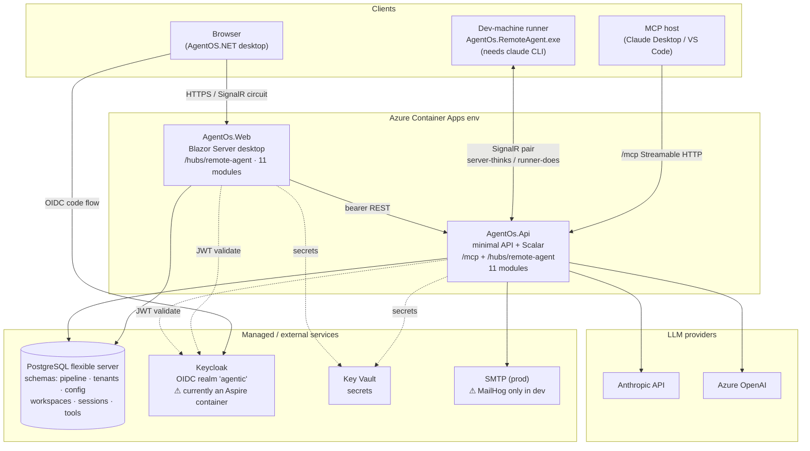
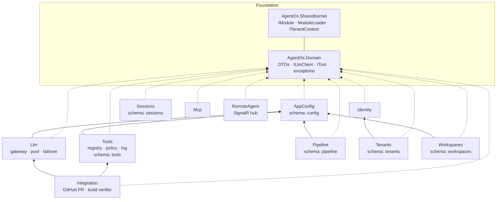
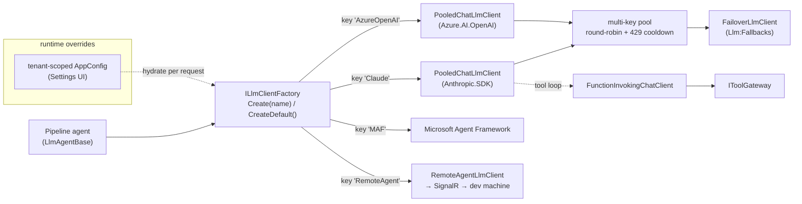
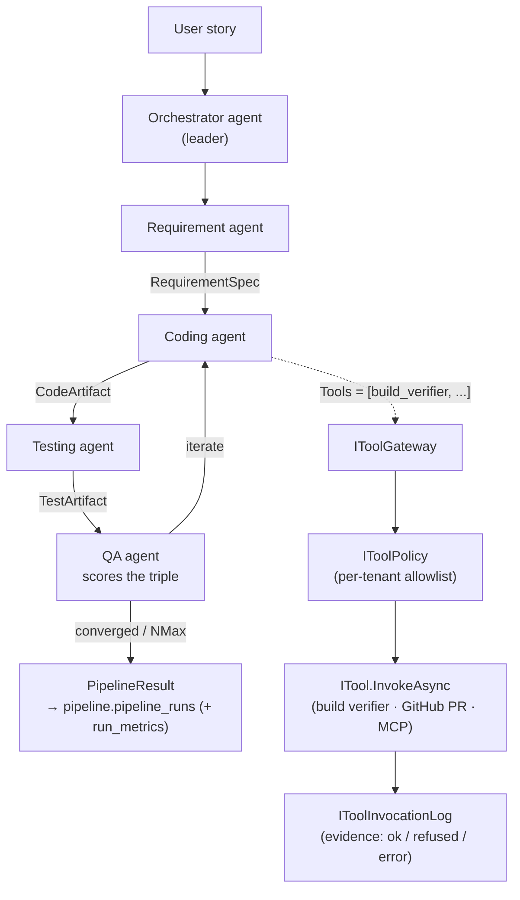
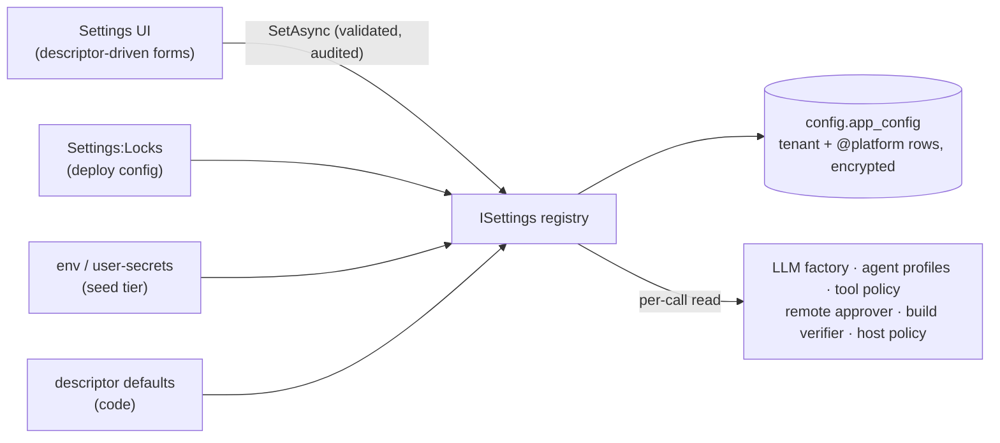

# AgentOS.NET — Architecture

> Source of truth for the system shape. Diagrams are [Mermaid](https://mermaid.js.org/) — they
> render on GitHub and in most Markdown viewers. Verified against the code on 2026-10-17
> (csproj references, host module sets, hub mapping).

AgentOS.NET is a **.NET 10 modular monolith**: every feature is a self-contained `IModule` that
references **`AgentOs.Domain` + `AgentOs.SharedKernel` only**, owns its DbContext + Postgres schema
+ migration history, and is wired into a host by one `AddModulesFromAssemblies(...)` call. Two
composition roots ship the product: the **Api** (minimal API + `/mcp` + the SignalR hub) and the
**Web** (Blazor Server AgentOS.NET desktop).

---

## 1. Deployment topology

How the pieces run in production (Azure Container Apps via Aspire + `azd`) and where the dev-machine
runner plugs in.



**Deploy notes / risks**
- `azd up` deploys the whole Aspire app model. Keycloak is declared as a **container** in
  `infra/AgentOs.AppHost/Program.cs` → it lands in ACA too. Keycloak-in-a-container (bootstrap
  admin param, data volume, theme bind-mount) is **not a production identity story** — use a managed
  Keycloak / Entra External ID and point `Auth:Keycloak:Authority` at it.
- MailHog is gated behind `if (!isPublish)` (run-mode only, "never ship to cloud"), so it does **not**
  land in ACA; it is a dev catcher and prod needs a real `Email:SmtpHost`.
- Both hosts load the RemoteAgent module and map `/hubs/remote-agent`; the runner defaults to the Api
  hub (`https://localhost:5080/hubs/remote-agent`) and can be pointed at the Web host instead.

---

## 2. Module dependency graph (modular monolith)

Every module sits on `Domain` + `SharedKernel`. Cross-module edges are explicit and minimal
(verified from `.csproj` references).



| Host | Modules included |
|---|---|
| **Api** | AppConfig, Llm, Tools, Pipeline, Integration, Identity, Tenants, Workspaces, Sessions, **Mcp**, **RemoteAgent** (all 11) |
| **Web** | the same 11 modules, plus the desktop shell (`AgentOs.Web.Shell`) |

---

## 3. LLM gateway (provider-agnostic)

The 5 agents depend only on `ILlmClient` (Domain). The factory resolves a keyed client by its
**canonical** provider name; the pooled client round-robins a multi-key pool and fails over on 429.



> Canonical keys are **`Claude`** and **`AzureOpenAI`**. Agent profiles (Settings → Agent profiles,
> default `Anthropic`) may use aliases — `Anthropic` for `Claude`, `Azure`/`OpenAI` for `AzureOpenAI`;
> `LlmClientFactory.NormalizeKey` maps them before the keyed lookup. A keyless `Offline` client sits at
> the end of every failover chain only when `Llm:OfflineFallback` is on (Development default; locked
> off in Production), and every run it serves is flagged Offline.

---

## 4. Pipeline — Leader / Specialists / Quality loop

A user story flows through 4 specialists; QA scores requirement↔code↔test consistency and loops
until convergence or the `NMax` iteration cap. Tools run through the governance seam.



**Governance moat:** every tool call — local, MCP, or dispatched to a remote runner — passes through
`IToolGateway → IToolPolicy → ITool → IToolInvocationLog`. The server decides and records; the
runner only executes ("server thinks, runner does").

---

## 5. Persistence & multi-tenancy

- One Postgres, **one schema per module** (`pipeline`, `tenants`, `config`, `workspaces`,
  `sessions`, `tools`), each with its own `__EFMigrationsHistory`. Each module applies its migrations
  at startup via its init hook.
- No connection string **+ `Persistence:RequireDatabase=false`** ⇒ modules fall back to **no-op
  repositories** so a host boots stateless (dev / CI). Production sets `RequireDatabase=true` (default
  in Api; forced true for Web in Production), so the persistence modules (Pipeline, Workspaces,
  Sessions, …) **throw at startup** when the connection string is empty — a missing connection string
  fails to boot rather than losing data.
- Row-level isolation: tenant-scoped entities carry `TenantId` + an EF global query filter reading
  `ITenantContext.TenantId`. Auth is Keycloak OIDC only (RS256, `tenant` claim); the API validates
  bearer tokens against the realm JWKS, the Web uses cookie + OIDC.
- A Blazor interactive-Server component has no `HttpContext` → read the tenant from
  `AuthenticationState`, never from `ITenantContext` inside a circuit.

---

## 6. Configuration (UI-first)

Modules declare their settings as `SettingDescriptor`s (`ISettingsContributor`); the AppConfig
module's registry resolves each read per call — **lock → tenant → platform → seed → code default** —
validates and audits every write, and the desktop renders the forms from the descriptors.
`appsettings.json` carries bootstrap keys only. See [ADR-0011](adr/0011-ui-first-configuration.md)
and [CONFIG.md](CONFIG.md).



## 7. Desktop

`AgentOs.Web.Shell` is the window manager and UI kit (scoped per circuit: windows, toasts); `AgentOs.Web`
registers the product apps in `AppCatalog` (Insights, Workflow, Board, Settings, Terminal, Files, and
the Settings-hub screens) and renders them as windows. Design rules: [design-system.md](design/design-system.md).
Plugins (`IAgentOsPlugin`, loaded from `plugins/`) can add tools, providers and windows.

## 8. Performance benchmarks

Hot paths are measured, not guessed (owner directive 2; plan §2.7 / PR 1.9). `tests/AgentOs.Benchmarks` is a
[BenchmarkDotNet](https://benchmarkdotnet.org/) console app in `AgentOs.slnx`; it is **not** a test project, so
`dotnet test` never runs it. Every benchmark runs with the memory diagnoser, uses realistic inputs, and touches no
network or database (the EF settings store runs on the EF in-memory provider).

| Area | Benchmarks | Why it is hot |
|---|---|---|
| LLM gateway | `CostCalculatorBenchmarks` (exact id, dated/Vertex snapshots, unknown model, long-context tier), `ModelCapabilitiesBenchmarks` | priced and shaped on every LLM call; the budget gate reads the price |
| Settings (ADR-0011) | `SettingsServiceBenchmarks` (tenant → platform → seed → default chain), `AppConfigStoreBenchmarks` (EF store cache hits) | read on every LLM call, policy check and agent profile lookup |
| Prompt text | `UntrustedTextBenchmarks`, `RepoInstructionsBenchmarks`, `PullRequestTextBenchmarks`, `JsonExtractorBenchmarks` (~100 KB replies: bare, fenced, prose-wrapped) | every agent prompt / reply / PR |
| Queues | `SessionRunFeedBenchmarks` (publish fan-out, subscribe round trip), `ToolEvidenceBenchmarks` (buffered evidence enqueue + drain) | on the agent's critical path |
| Desktop folds | `InsightsFoldBenchmarks` (by-role folds, `AgentRoles.Canonical`), `SettingsSearchBenchmarks` (per keystroke), `KnowledgeLayoutBenchmarks` | run per render / keystroke on the Blazor circuit |

```bash
# Everything (ShortRun, ~20 min) — artifacts land in ./BenchmarkDotNet.Artifacts (git-ignored)
dotnet run -c Release --project tests/AgentOs.Benchmarks -- --filter '*' --job short
# One class, full statistical run
dotnet run -c Release --project tests/AgentOs.Benchmarks -- --filter '*CostCalculator*'
# The perf gate: compare a run with the committed baseline (exit 1 on regression, 2 on bad arguments / no data)
dotnet run -c Release --project tests/AgentOs.Benchmarks -- compare tests/AgentOs.Benchmarks/baseline BenchmarkDotNet.Artifacts/results
#   [--threshold 0.20|20%] [--timing gate|advisory] [--require-all] [--alloc-floor-bytes 64] [--noise-floor-ns 2]
```

**Regression gate.** `.github/workflows/perf.yml` (manual + nightly) runs the suite with `--job short`, uploads the
BenchmarkDotNet artifacts, and runs the comparer against `tests/AgentOs.Benchmarks/baseline/*.json` (BenchmarkDotNet's
brief JSON reports). The job fails when a benchmark:

- **allocates more** — its baseline allocates **0 B** and it now allocates anything, or its allocated bytes per
  operation grow by more than the threshold (20 %) **plus a 64 B floor** (one extra small object is not a regression);
- **crashes** — the report lists it without statistics, or the run itself exits non-zero (a failed build/run or a
  critical validation error makes the benchmark run exit 1);
- **is missing on a full run** — with `--filter '*'` the workflow passes `--require-all`, so a baseline benchmark that
  never produced a report fails instead of passing as "not run" (a filtered run reports missing rows, never fails);
- **got slower** — its Mean grows by more than 20 % (and by more than a 2 ns noise floor). This is a **failure only on
  manual runs** (`timing: gate`, the default for `workflow_dispatch`); on the **nightly it is advisory**: a `::warning`
  annotation and a ⚠️ row in the summary, not a red job (see the machine caveat below).

`--threshold` takes a fraction in (0, 1] (`0.20`) or a percentage with `%` (`20%`); a bare `20` is rejected rather than
read as 2000 %. New benchmarks are reported, never failed. The nightly's concurrency group is separate from manual runs
and never cancels in progress. The comparer (`Comparison/BaselineComparer.cs`, `Comparison/ComparerArguments.cs`) is
pure BCL and unit-tested in `AgentOs.Tests` (`BaselineComparerTests`).

**Machine caveat.** Absolute timings belong to the machine that recorded them. The committed baseline was recorded
on a 4-vCPU cloud Linux VM (see `HostEnvironmentInfo` inside each baseline file), not on a GitHub-hosted runner, and
shared runners are noisy; the nightly's ShortRun job (3 iterations) on that hardware against a fixed 2 ns floor would
fail on noise alone. That is why the nightly gates on allocations only — they are machine-independent and the reliable
signal — and reports timing as advisory. The simpler alternative (benchmark base and head in the same job) was rejected
for now: it doubles the run time and still compares two noisy ShortRuns. Treat an advisory timing warning as "re-run on a
quiet machine (or dispatch with `timing: gate`) before you believe it". To re-record: download the `benchmark-results`
artifact of a `perf.yml` run on `main`, copy its `results/*-report-brief.json` over `tests/AgentOs.Benchmarks/baseline/`,
and commit that with a note of the runner it came from.
