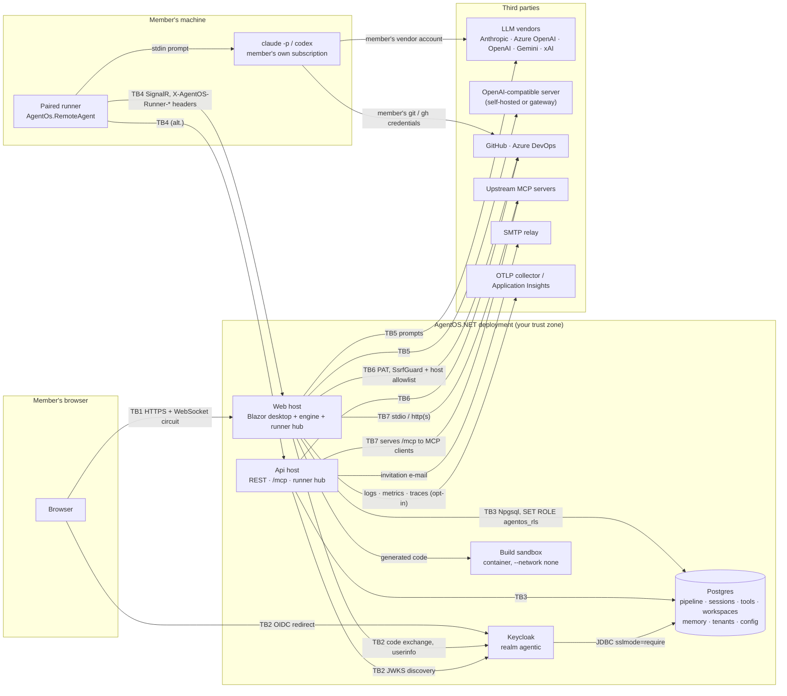
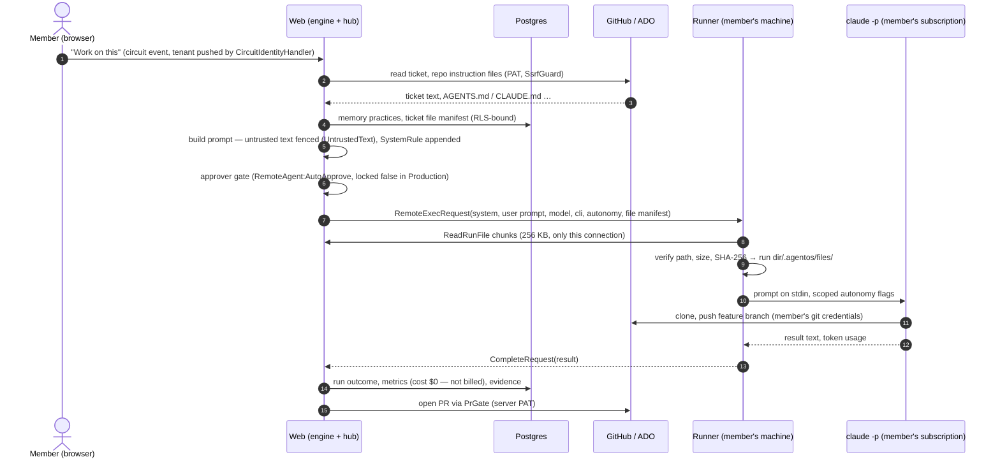
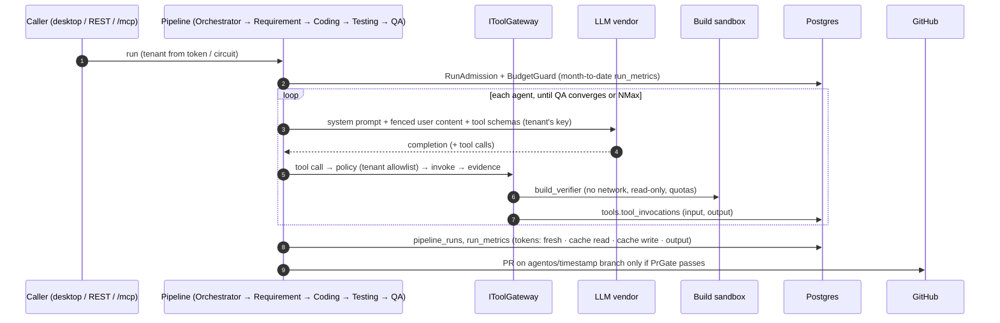

# AgentOS.NET — Data flow

> Companion to the [threat model](threat-model.md) (boundary ids TB1-TB8 match). Verified against `main` @
> `28b05ed`. What leaves the deployment and to whom is in [subprocessors.md](subprocessors.md).

## 1. Context — everything that talks to AgentOS.NET

## 2. A Board run on a member's machine (RemoteAgent)

## 3. A server-side pipeline run (vendor LLM)

## 4. What crosses each boundary

| Boundary | Direction | Data | Protection in transit | Protection at rest / control | Code |
|---|---|---|---|---|---|
| **TB1** Browser ↔ Web | both | UI events, rendered diffs, ticket text, code previews, uploaded ticket files, tenant export / audit CSV downloads | TLS at the ingress (`allowInsecure: false`); circuit over the same TLS | Auth cookie (HttpOnly, Secure, Lax) holds the OIDC tokens encrypted by DataProtection | `src/AgentOs.Web/Program.cs:139-187`; `infra/AgentOs.AppHost/infra/web.tmpl.yaml:15-19` |
| **TB2** Browser / Web ↔ Keycloak | both | Credentials (typed at Keycloak only), authorization code, ID / access / refresh tokens, `tenant` + realm roles claims | TLS; code flow + PKCE; PAR disabled | Keycloak DB (Postgres in the cloud) | `src/AgentOs.Web/Program.cs:164-175`; `infra/keycloak/agentic-realm.json` |
| **TB2** Api ↔ Keycloak | Api → KC | JWKS / discovery fetch; Keycloak admin calls (create user, reset password, delete) from the Tenants module | TLS (`RequireHttpsMetadata` default on) | — | `src/AgentOs.Modules.Identity/Auth/JwtAuthExtensions.cs:29-70`; `src/AgentOs.Modules.Tenants/Keycloak/KeycloakAdminClient.cs` |
| **TB3** Hosts ↔ Postgres | both | Every persisted row: runs, metrics, evidence, sessions, ticket file bytes, memory, workspaces, audit, encrypted settings, key ring | TLS only by server default (no `SslMode` in the app connection string) | RLS on 16 tables (`agentos_rls`); DataProtection on `app_config`; Azure-managed storage encryption | `src/AgentOs.SharedKernel/Persistence/RowLevelSecurity.cs`; `infra/postgres/postgres.module.bicep` |
| **TB4** Server → runner | push | System + user prompt (ticket text, rules, practices, file list), model id, CLI name, autonomy mode, file manifest + bytes, `shell` / `write_files` tool calls, Cancel | TLS when the hub URL is `https://` (not enforced) | Per-run folder, deleted after the run; `write_files` folders after 3 days; **no vendor key, no PAT sent** | `src/AgentOs.Modules.RemoteAgent/IRemoteAgentBroker.cs:35-68`; `src/AgentOs.RemoteAgent/ScopedAutonomy.cs:118-157` |
| **TB4** Runner → server | push | Result text (CLI final answer, stderr on failure), token usage, progress step keys, tool output (≤ 32 KB), preview state, Design-gate screenshots (`UploadRunFile`, [ADR-0016](../adr/0016-design-gate.md)) | same | Stored in `sessions.*` error/outcome columns, broadcast on the tenant's session feed, unredacted | `src/AgentOs.RemoteAgent/Program.cs:327-380`; `src/AgentOs.Domain/Sessions/InMemorySessionRunFeed.cs` |
| **TB4** Runner CLI → vendor / SCM | runner → third party | Whatever the member's CLI sends under the member's own account (prompt, repo content it reads) | Vendor TLS | Member's own vendor terms; outside AgentOS.NET | `src/AgentOs.Modules.RemoteAgent/RemoteAgentLlmClient.cs:1-3` |
| **TB5** Engine → LLM vendor | both | System prompt (agent prompt, workspace rules, repo guidance), user content (fenced tickets, code, test output), Design-gate screenshots as images (`LlmMessages.cs`), tool schemas; completions + usage back | Vendor TLS; fixed vendor URLs except Azure (tenant-set, https) and OpenAI-compatible (platform-set, http or https) | Not stored by AgentOS.NET beyond run artifacts and metrics; vendor retention per contract | `src/AgentOs.Modules.Llm/PooledChatLlmClient.cs:135-277`; `VendorProviders.cs:40-48` |
| **TB6** Engine ↔ GitHub / ADO | both | Ticket / issue text, repo files and instruction files (read); branches, commits of generated code + tests, PR title/body, issues, review comments (write); PAT in the `Authorization` header | TLS; host allowlist; `SsrfGuard` | PAT encrypted in `app_config` | `src/AgentOs.Modules.Integration/GitHubPrService.cs:127-170`; `src/AgentOs.Modules.Workspaces/Security/WorkspaceHostPolicy.cs` |
| **TB7** Engine → upstream MCP | both | Tool arguments chosen by the model; tool output (≤ 64 KB) | `stdio` (local process) or http(s) with `SsrfGuard` | Evidence row per call | `src/AgentOs.Modules.Mcp/McpClientHost.cs:53-212` |
| **TB7** MCP client → `/mcp` | both | `run_pipeline` input (requirement text), run summaries | TLS; bearer JWT or `aos_…` API token | Run history | `src/AgentOs.Api/Program.cs:236-239`; `src/AgentOs.Api/Mcp/PipelineMcpTools.cs` |
| **TB8** Untrusted text → prompt | inbound | Ticket title/body, review comments, file names, memory practices, repo instruction files, autopilot state | — | Fenced (`UntrustedText`, `<repo_guidance>`, `<workspace_rules>`), capped | `src/AgentOs.Domain/Llm/UntrustedText.cs`; `src/AgentOs.Domain/Workspaces/RepoInstructions.cs` |
| Build sandbox | engine → container | Generated source files (sanitised), build output back | Local container, `--network none` | Ephemeral scratch dir | `src/AgentOs.Modules.Integration/Sandbox/ContainerCommand.cs:26-55` |
| E-mail | Api → SMTP | Invitation: tenant id, role, accept URL with token | STARTTLS / implicit TLS if configured, else plaintext | — | `src/AgentOs.Modules.Tenants/Email/MailKitEmailSender.cs:49-53`; `InvitationEmail.cs:12-39` |
| Telemetry (opt-in) | hosts → collector | Logs (formatted message + scopes incl. tenant id, trace id), metrics, traces (HTTP, LLM spans: model, tenant, tokens, cost — no prompt bodies) | OTLP / App Insights TLS | Collector retention; Log Analytics default retention | `src/AgentOs.ServiceDefaults/Extensions.cs:79-100`; `src/AgentOs.SharedKernel/Telemetry/LlmTelemetry.cs:51-82` |

## 5. Data classes

| Class | Examples | Tenant-scoped | Encrypted by AgentOS.NET | Exported by tenant export | Retention today |
|---|---|---|---|---|---|
| Credentials | LLM keys, PATs, board tokens, OpenAI-compatible key | yes (platform rows under `__platform`) | DataProtection | ciphertext only (see threat model GAP-08) | until changed |
| Identity | username, email, roles, `tenant` attribute | yes (Keycloak attribute) | Keycloak | no (Keycloak) | until member removed / tenant purged |
| Customer content | tickets, code, test output, ticket files, memory | yes | no (storage-level only) | yes | **no policy** — until tenant purge |
| Governance | tool evidence (full input/output), audit events, run metrics | yes | no | yes | **no policy** |
| Telemetry | logs, metrics, traces | tenant id attribute | no | n/a | collector default |
